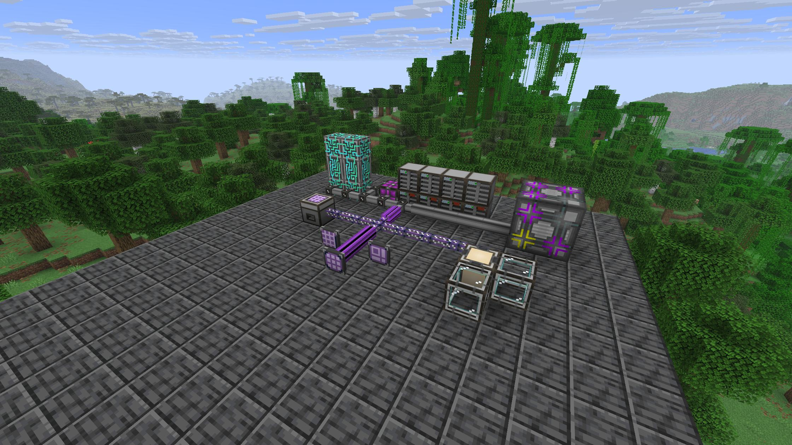
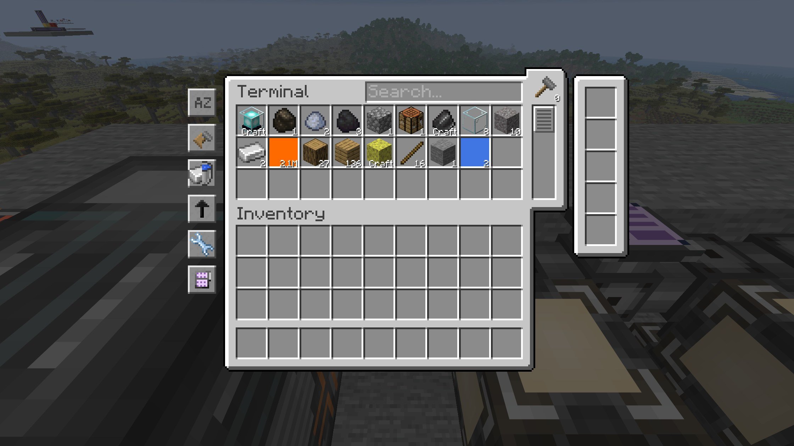
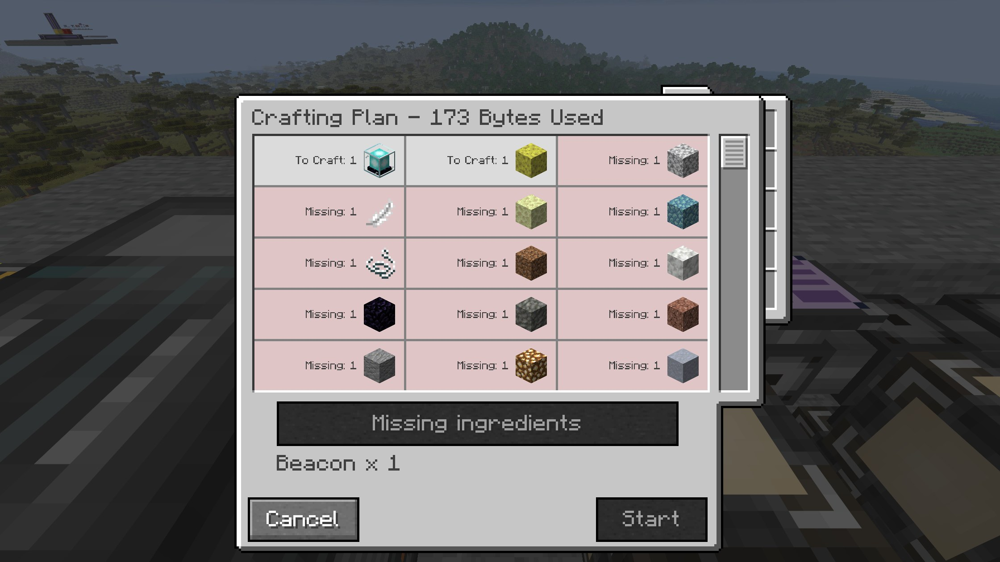
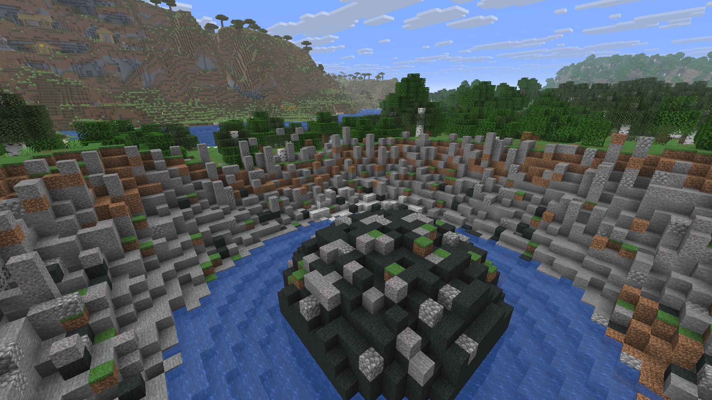

# Applied Energistics 2 for Sunrise (Early Access)

Applied Energistics 2 (TeamAppliedEnergistics, LGPL-3.0; textures, models, sounds and guide CC BY-NC-SA 3.0; see
`LICENSE`, `NOTICE`) as a native mod on Sunrise's mod API. The Rust code is a rewrite; no Java code runs.

**Early Access:** everything below works and is tested, but it is a large mod on a young modding API. Expect rough
edges, and report what you find in this repository's issues.

- **Mod id** `ae2`, **version** 15.4.14.
- **Game build:** pinned to Sunrise Dev 2026-11-22, game commit `7cfdf81463ebb4a19705768273909f7f3f03601d`,
  Minecraft 26.3. The launcher compiles the mod from this source against that build; a newer build needs a repinned
  release.
- **Native code is not sandboxed:** the launcher asks you to trust it before building it.
- **Optional:** `jei` (AE2's recipe categories and the terminal's recipe transfer), `jade` (network and part details),
  `guideme` (the W guide). AE2 works without them.

## Screenshots

| | |
|---|---|
|  |  |
|  |  |

## What is in it

- **ME network:** controllers, cables (glass, covered, smart, dense, in every colour), channels, energy acceptors and
  cells, the network tool's status screen and its upgrade toolbox.
- **Storage:** ME drives and chests, item and fluid cells of every size, portable cells, partitioning, fuzzy cards,
  the IO port, storage and import/export buses, level emitters.
- **Terminals:** ME terminal, crafting terminal (with JEI "+" transfer), pattern encoding terminal, pattern access
  terminal, wireless terminals and the wireless access point.
- **Autocrafting:** crafting CPUs (storage, co-processors, monitors), crafting, processing and smithing patterns,
  pattern providers, molecular assemblers, the crafting status screen with a time-left estimate.
- **The cable bus:** parts and facades sharing one cable block, with their own hit boxes and menus.
- **P2P tunnels** (ME, items, fluids, redstone, light), **spatial storage** (pylons, IO port, cells, anchor), the
  **quantum network bridge**.
- **World:** meteorites with their mysterious cubes and presses, certus quartz growth and the growth accelerator,
  in-world crafting (fluix crystals in water, and the rest), the charger, the inscriber, the entropy manipulator, the
  matter cannon, the Fluix Researcher villager and its trades.
- **Config files** in `config/ae2/`, with AE2's own keys and defaults.

## Building it yourself

`cargo sunrise-mod check` and `cargo sunrise-mod build` in this folder, with the Sunrise mod tool for the pinned build.
